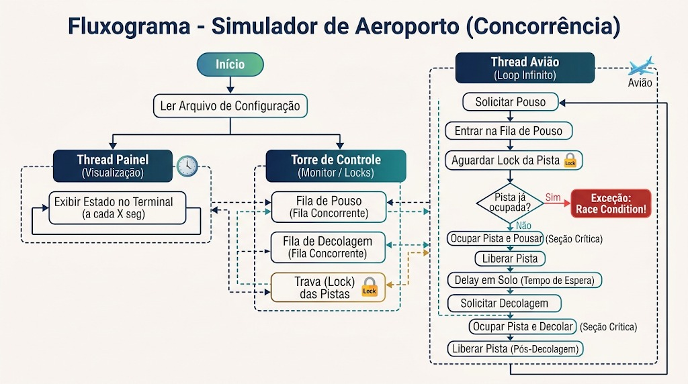

# Simulador de Aeroporto — Projeto de Concorrência (2ª VA)

Simulador concorrente de aeroporto escrito em Java, em que cada avião é uma thread.
Uma torre de controle coordena o uso das pistas, e um painel no terminal mostra o estado do sistema.

## Equipe

| Pessoa | Módulo | Revisor |
|---|---|---|
| Pessoa 1 | Torre e filas | Pessoa 3 |
| Pessoa 2 | Aviões e ciclo de vida | Pessoa 4 |
| Pessoa 3 | Pistas e exceções | Pessoa 1 |
| Pessoa 4 | Painel, config e integração | Pessoa 2 |

## Como compilar e executar

```bash
javac -encoding UTF-8 -d out $(find src -name '*.java')
java -cp out aeroporto.torre.TesteTorre
```

Execução do simulador completo: a preencher (Pessoa 4).

## Arquitetura



Figura de arquitetura final: a preencher (Pessoa 4).

## Torre de controle e filas (Pessoa 1)

A torre é a única parte do sistema que reserva pistas: os aviões pedem pouso ou decolagem,
entram numa fila e esperam até receber uma `Autorizacao` com a pista que podem usar.
Ao terminar, o avião avisa a torre, que libera a pista e despacha o próximo da fila.

- **A torre é a única que reserva pistas**: nenhum avião escolhe pista sozinho.
- **`ReentrantLock` + `Condition`**: uma trava justa protege filas e reservas; os aviões
  dormem em `await()` até a torre conceder uma pista e chamar `signalAll()`.
- **Prioridade**: emergência → aging (anti-starvation) → alternância entre pousos e decolagens.

Detalhes em [docs/README-torre.md](docs/README-torre.md).

## Aviões e ciclo de vida (Pessoa 2)

A preencher.

## Pistas, exceções e controle de concorrência (Pessoa 3)

A preencher.

## Painel, configuração e estatísticas (Pessoa 4)

A preencher.

## Mecanismos de concorrência não vistos em sala

- **`ReentrantLock` (justo)**: trava explícita que, criada com `new ReentrantLock(true)`,
  atende as threads na ordem de chegada e permite criar `Condition`.
- **`Condition` (`await` / `signalAll`)**: permite que os aviões esperem pela autorização
  sem gastar CPU e sejam acordados quando a torre libera uma pista.

Mais detalhes em [docs/README-torre.md](docs/README-torre.md).

Demais mecanismos: a preencher.

## Linhas que desativam o controle de concorrência

| Marcação | Arquivo | O que acontece se comentar |
|---|---|---|
| `[CONTROLE-CONCORRENCIA #T1]` | `TorreDeControle.java`, método `despachar()` | A torre entrega a mesma pista a dois aviões e a `Pista` lança a exceção "Pista 1 já ocupada por AD 2774 quando AD 4410 tentou usar". |

Demais linhas: a preencher (Pessoa 3).

## Código reaproveitado

Nenhum código externo reaproveitado até o momento.

## Uso de IA generativa

Cada membro da equipe registra aqui o que fez com apoio de IA generativa, indicando a
ferramenta e o modelo utilizados.

- **Pessoa 1:** A preencher.
- **Pessoa 2:** A preencher.
- **Pessoa 3:** A preencher.
- **Pessoa 4:** A preencher.
