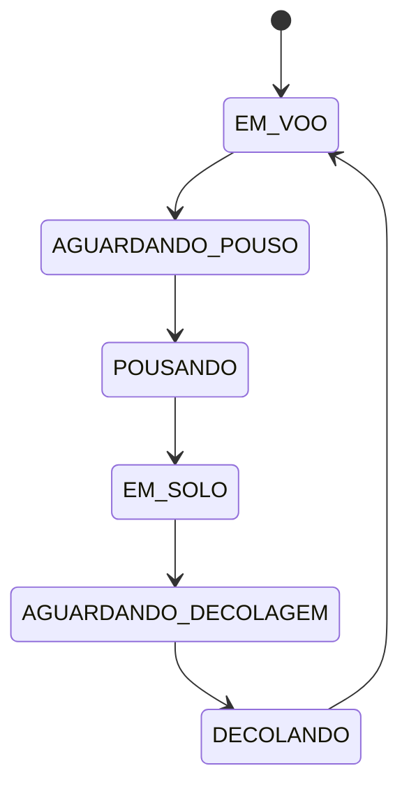

# Simulador de Aeroporto — Projeto de Concorrência (2ª VA)

Simulador concorrente de aeroporto escrito em Java, em que cada avião é uma thread.
Uma torre de controle coordena o uso das pistas, e um painel no terminal mostra o estado do sistema.

## Equipe

| Pessoa | Módulo | Revisor |
|---|---|---|
| Pessoa 1 | Torre e filas | Pessoa 3 |
| Ana Luisa | Aviões e ciclo de vida | Pessoa 4 |
| M Eduarda | Pistas e exceções | Pessoa 1 |
| Pessoa 4 | Painel, config e integração | Pessoa 2 |

## Como compilar e executar

Linux / macOS / Git Bash:

```bash
javac -encoding UTF-8 -d out $(find src -name '*.java')
```

Windows (PowerShell):

```powershell
chcp 65001
javac -encoding UTF-8 -d out (Get-ChildItem -Recurse -Filter *.java src).FullName
```

O `chcp 65001` faz os acentos aparecerem certos no terminal do Windows.

Testes de cada módulo:

```bash
java -cp out aeroporto.aviao.TesteAviao
java -cp out aeroporto.torre.TesteTorre
java -cp out aeroporto.pista.TestePista
```

Execução do simulador completo no terminal:

```bash
# Cenário 1: Balanceado (3 pousos, 3 decolagens, 2 pistas)
java -cp out aeroporto.simulador.Simulador C1

# Cenário 2: Pista única sob estresse de pouso (4 pousos, 1 pista)
java -cp out aeroporto.simulador.Simulador C2

# Ou passando arquivo de configuração customizado diretamente:
java -cp out aeroporto.simulador.Simulador cenarios/C1.properties
```

Para encerrar o painel no terminal a qualquer momento e ver o relatório final consolidado, aperte `Ctrl + C`.

### Modo Gráfico Interativo (Java Swing)

Além do terminal animado com ANSI, o projeto inclui uma interface gráfica moderna em Java Swing com radar 2D, silhueta vetorial de jatos, botões de emergência e interdição de pista:

```bash
# Executa a interface gráfica Swing (Cenário C1 por padrão)
java -cp out aeroporto.simulador.SimuladorSwing

# Ou passando a flag --gui para o Simulador principal
java -cp out aeroporto.simulador.Simulador C1 --gui
```

## Arquitetura


```
                      ┌───────────────────────────────────────────┐
                      │          Simulador (main)                 │
                      │  - Carrega Configuracao (C1, C2...)       │
                      │  - Inicializa Pistas, Torre, Aviões       │
                      │  - Registra Shutdown Hook (Ctrl + C)      │
                      └─────────────┬─────────────────────────────┘
                                    │ instancia e inicia
            ┌───────────────────────┼───────────────────────────┐
            ▼                       ▼                           ▼
  ┌──────────────────┐   ┌──────────────────────┐    ┌────────────────────┐
  │  Avião (Thread)  │   │   TorreDeControle    │    │  Pista (Exclusiva) │
  │  (Pessoa 2)      ├──▶│   (Pessoa 1)         │◀───│  (Pessoa 3)        │
  │  Ciclo infinito: │   │  - FilaDePouso       │    │  - AtomicReference │
  │  Voo ↔ Solo      │   │  - FilaDeDecolagem   │    │  - CAS fiscalizador│
  │  Emergência /    │   │  - Lock justo        │    │  - Manutenção /    │
  │  Combustível     │   │  - Condition (await) │    │    Fechamento      │
  └─────────┬────────┘   └──────────┬───────────┘    └─────────┬──────────┘
            │                       │                          │
            │                       │                          │
            └───────────────────────┼──────────────────────────┘
                                    │ publica eventos / lê métricas
                                    ▼
       ┌────────────────────────────────────────────────────────┐
       │   RegistroDeEventos (Buffer Circular Thread-Safe)      │
       │   EstatisticasDaTorre (Extra 6 - Métricas da Torre)    │
       │   MonitorDeInvariantes (Extra 7 - Auditor Concorrente) │
       └────────────────────────────┬───────────────────────────┘
                                    │ lê snapshots sem travar
                                    ▼
       ┌────────────────────────────────────────────────────────┐
       │          PainelDeControle (Thread ANSI Animada)        │
       │          Interface Gráfica Swing (Radar ATC 2D)        │
       │  - Redesenho suave sem piscar (\033[H) a cada 120ms    │
       │  - Céu e aproximação com arte ASCII                    │
       │  - Pistas com asfalto animado e avião se deslocando    │
       │  - Solo, taxiway, status de invariantes e teletype     │
       └────────────────────────────────────────────────────────┘
```

---

## Torre de controle e filas (Pessoa 1)

A torre é a única parte do sistema que decide quem usa qual pista e quando.
Os aviões nunca escolhem pista sozinhos: pedem à torre, esperam e usam só a pista
que veio na `Autorizacao`.

```
Avião ──pedirPouso()/pedirDecolagem()──▶ Torre ──(entra na fila, dorme)
                                          │
                       pista fica livre ──┤ despachar(): escolhe quem sai da fila,
                                          │ reserva a pista e acorda o avião
Avião ◀──────────── Autorizacao(pista) ───┘
Avião usa a pista ─▶ pista.liberar() ─▶ torre.concluirOperacao() ─▶ despachar() de novo
```

### Classes

| Classe | Papel |
|---|---|
| `TorreDeControle` | Recebe pedidos, mantém as filas, reserva pistas e entrega autorizações |
| `FilaDeEspera` | Base das filas: emergência → aging → ordem de chegada |
| `FilaDePouso` / `FilaDeDecolagem` | As duas filas da torre (só a de pouso respeita emergência) |
| `Autorizacao` | Bilhete imutável: avião + pista + tipo (pouso/decolagem) |
| `TipoOperacao` | `POUSO` ou `DECOLAGEM` |
| `ExcecaoAutorizacaoIndevida` | Asserções da torre (ver abaixo) |
| `EstatisticasDaTorre` | Números da torre para o painel (Extra 6), imutável |
| `RetratoDaTorre` | Foto consistente das filas e reservas num instante, imutável (base do Extra 7) |

### Política de prioridade

Quando uma pista fica livre, a torre decide nesta ordem:

1. **Emergência (Extra 1):** avião em emergência na fila de pouso passa na frente de todos.
2. **Anti-starvation / aging (Extra 2):** quem esperou mais que o limite configurado sobe
   de prioridade dentro da fila; se for alguém da fila de decolagem, a decolagem ganha a vez.
3. **Alternância:** pouso tem preferência (avião no ar gasta combustível), mas depois de
   N pousos seguidos uma decolagem passa, para as decolagens não travarem.
4. Fora isso, ordem de chegada (FIFO).

### Mecanismos de concorrência

- **`ReentrantLock` (justo):** uma única trava protege as filas, o mapa de autorizações e as
  reservas de pista. Funciona como o `synchronized`, mas permite criar `Condition` e
  atender as threads na ordem de chegada (`new ReentrantLock(true)`).
- **`Condition` (`await` / `signalAll`):** o avião que pediu fica dormindo em
  `autorizacaoDisponivel.await()` sem gastar CPU. Quando a torre concede alguma pista,
  chama `signalAll()`; cada avião acorda, confere se a autorização é **dele** e, se não for,
  volta a dormir (o `while` em volta do `await` protege contra acordar à toa).
- **Objetos imutáveis:** `Autorizacao` só tem campos `final`, então pode passar de uma
  thread para outra sem trava.
- **Cópias para o painel:** `getFilaDePouso()` e `getFilaDeDecolagem()` devolvem cópias,
  então o painel nunca percorre a lista real enquanto a torre mexe nela.

### Asserções (`ExcecaoAutorizacaoIndevida`)

- Um avião nunca está nas duas filas ao mesmo tempo.
- Só recebe autorização quem estava na fila; ninguém recebe duas autorizações seguidas.
- Só pode concluir operação na pista o avião para quem a torre reservou aquela pista.
- O avião precisa sair da pista (`pista.liberar`) **antes** de avisar a torre
  (`concluirOperacao`); senão a torre daria a pista ao próximo com ele ainda em cima dela.
- Ninguém sai da espera da torre sem ter recebido a própria autorização.

### O que a torre oferece ao painel (Pessoa 4)

| Método | Devolve | Para quê |
|---|---|---|
| `getFilaDePouso()` / `getFilaDeDecolagem()` | Cópia de cada fila | Mostrar as filas no painel |
| `getPistas()` | Cópia da lista de pistas | Mostrar o estado de cada pista |
| `getReservas()` | Pista → texto da autorização | Mostrar quem a torre autorizou em cada pista |
| `getRetrato()` | `RetratoDaTorre` | Filas e reservas lidas **todas no mesmo instante**, com a trava pega |
| `getEstatisticas()` | `EstatisticasDaTorre` | Totais, esperas médias e ocupação das pistas (Extra 6) |

**Por que o retrato existe:** chamando `getFilaDePouso()` e depois `getFilaDeDecolagem()`,
um avião pode mudar de fila entre uma chamada e outra e aparecer nas duas (ou em nenhuma),
sem ser erro de verdade. O retrato lê tudo de uma vez, então o que ele mostra é real.
Ele tem `verificarConsistencia()`, que devolve a lista de problemas encontrados (vazia se
estiver tudo certo): avião duplicado numa fila, avião nas duas filas, avião na fila e com pista
reservada ao mesmo tempo, avião com duas pistas. O monitor de invariantes (Extra 7) pode
chamar isso a cada ciclo.

**Estatísticas (Extra 6)**, todas calculadas pela torre:

| Número | Como é medido |
|---|---|
| `getTotalPousos()` / `getTotalDecolagens()` | Operações concluídas (`concluirOperacao`) |
| `getEsperaMediaPousoMillis()` / `getEsperaMediaDecolagemMillis()` / `getEsperaMediaGeralMillis()` | Do momento em que o avião entra na fila até a torre conceder a pista |
| `getMaiorEsperaMillis()` | A maior espera registrada até agora |
| `getEmergenciasAtendidas()` | Aviões em emergência que receberam pista para pousar |
| `getOcupacaoPercentual(pista)` | Tempo em que a pista ficou reservada ÷ tempo total da simulação |
| `getOperacoesPorPista()` | Pousos + decolagens concluídos em cada pista |

Exemplo de uso no painel:

```java
EstatisticasDaTorre est = torre.getEstatisticas();
System.out.println(est); // "Pousos: 12 | Decolagens: 11 | Espera média: ... | Pista 1: 85% | ..."

RetratoDaTorre r = torre.getRetrato();
List<String> problemas = r.verificarConsistencia();
```

Os dois objetos são **imutáveis**: a torre os monta com a trava pega e entrega prontos,
então o painel pode lê-los de qualquer thread sem lock e sem atrasar a torre.

### Avião interrompido enquanto espera

Se a thread do avião for interrompida enquanto dorme na torre (ex.: fim da simulação, Ctrl+C),
a torre desfaz o que tinha feito por ele:

- se ele ainda estava na fila, sai da fila;
- se a autorização já tinha sido concedida mas ele não chegou a buscá-la, a pista reservada
  é devolvida e vai para o próximo da fila.

Sem isso, uma pista poderia ficar reservada para sempre para um avião que nunca vai usá-la.
Com uma pista só (cenário C2), o aeroporto inteiro pararia.

### Como testar

```bash
java -cp out aeroporto.torre.TesteTorre
```

| Teste | O que confere |
|---|---|
| 1 | A emergência fura a fila de pouso |
| 2 | Um avião interrompido na fila sai dela e a pista continua disponível para os outros |
| 3 | A torre barra quem tenta concluir a operação sem ter liberado a pista |
| 4 | Estatísticas (totais, esperas, ocupação) e retrato da torre conferem com um cenário controlado |
| 5 | 8 aviões em 2 pistas por 5 segundos: falha se houver conflito de pista, se alguma fila não andar ou se o aeroporto ficar um segundo inteiro sem nenhuma operação (torre travada). Ao mesmo tempo, um monitor tira retratos da torre sem parar e falha se algum avião aparecer em dois lugares; no fim, as estatísticas precisam bater com o que os aviões fizeram |

---

## Aviões e ciclo de vida (Ana Luisa)

### O que o avião faz

Cada avião é uma thread (`Aviao implements Runnable`) com ciclo de vida infinito:
voa, pede pouso à torre, espera a autorização, pousa, fica em solo, pede decolagem,
espera a autorização, decola e volta a voar.

O avião **só conversa com a torre**: nunca fala com outro avião e nunca escolhe pista.
Ele usa somente a pista que veio na `Autorizacao`. A parte de esperar fica dentro de
`torre.pedirPouso()` e `torre.pedirDecolagem()`, que bloqueiam a thread até a autorização chegar.

```
Avião ──pedirPouso()──▶ Torre (fila, thread dorme)
Avião ◀── Autorizacao(pista) ──
Avião ─▶ pista.ocupar() ─▶ (usa a pista) ─▶ pista.liberar() ─▶ torre.concluirOperacao()
```

### Classes

| Classe | Papel |
|---|---|
| `Aviao` | Thread com o ciclo de vida, a máquina de estados e o combustível |
| `EstadoAviao` | Os 6 estados do avião e qual é o próximo de cada um |
| `ExcecaoTransicaoInvalida` | Lançada quando o avião tenta pular uma etapa do ciclo |
| `GeradorDeVoos` | Cria códigos de voo (AD, G3, LA e 2Z + número) sem repetir o número |
| `TesteAviao` | Testes do módulo, incluindo o ciclo completo com a torre real |

### Ciclo de vida e estados



| Estado | Significado |
|---|---|
| `EM_VOO` | Voando; passado um tempo, pede pouso |
| `AGUARDANDO_POUSO` | Na fila de pouso da torre, com a thread bloqueada |
| `POUSANDO` | Autorizado, usando a pista para pousar |
| `EM_SOLO` | Em solo (delay configurável); depois pede decolagem |
| `AGUARDANDO_DECOLAGEM` | Na fila de decolagem da torre, com a thread bloqueada |
| `DECOLANDO` | Autorizado, usando a pista para decolar |

O avião começa em `EM_VOO` (quer pousar) ou em `EM_SOLO` (quer decolar), conforme o cenário
do arquivo de configuração. O estado só muda no método `mudarEstado()`, que confere se a
transição é a permitida.

### Combustível (Extra 3)

Em voo e esperando para pousar, o combustível diminui com o tempo. O valor é calculado a partir
do instante em que o avião começou a voar e da autonomia definida na configuração
(de 100% até 0%). Quando fica abaixo do limite (por exemplo, 25%), `estaEmEmergencia()`
passa a ser `true`. A torre consulta esse método e coloca o avião na frente da fila de
pouso (Extra 1). Ao decolar, o avião é reabastecido e a contagem recomeça. Em solo,
o combustível fica em 100%.

### Asserções

- **Transição de estado:** só existe um caminho entre os estados. Pular uma etapa lança
  `ExcecaoTransicaoInvalida`, por exemplo: *"Transição inválida do voo AD 2774: não pode ir de
  AGUARDANDO_POUSO para DECOLANDO (o próximo estado correto seria POUSANDO)"*. Com isso, o avião
  só pousa vindo de `AGUARDANDO_POUSO` e só decola vindo de `AGUARDANDO_DECOLAGEM`.
- **Autorização:** ao receber o "bilhete" da torre, o avião confere se ele é dele e do tipo
  pedido (pouso ou decolagem). Senão, lança `ExcecaoAutorizacaoIndevida`.
- **Falhas visíveis:** se a pista detectar uma condição de corrida, o `run()` publica o erro
  no registro de eventos (que aparece no painel) e deixa a exceção derrubar a thread.

### Como testar

```bash
java -cp out aeroporto.aviao.TesteAviao
```

| Teste | O que confere |
|---|---|
| 1 | Cada estado só aceita o próximo do ciclo, e o ciclo de 6 estados fecha |
| 2 | O gerador cria 1000 códigos de voo sem nenhum repetido |
| 3 | Pular etapa lança `ExcecaoTransicaoInvalida` com mensagem que explica o motivo |
| 4 | Sem combustível, o avião entra em emergência |
| 5 | 6 aviões e 2 pistas com a torre real por 5 segundos: todos operam, sem nenhuma exceção |

---

## Pistas, exceções e controle de concorrência (Pessoa 3)

A pista é o recurso compartilhado do sistema: só pode ter **um avião por vez**.
Quem garante isso no funcionamento normal é a torre, que reserva cada pista para um avião só.
A `Pista` funciona como **fiscal**: se, por alguma falha no controle, dois aviões tentarem
usá-la ao mesmo tempo, ela percebe na hora e lança uma exceção explicando o que aconteceu.

```
Torre ──Autorizacao(pista)──▶ Avião
                               │
                               ├─▶ pista.ocupar(avião)   ── já tinha outro? ──▶ ExcecaoPistaOcupada
                               │      (pousa / decola)
                               └─▶ pista.liberar(avião)  ── não era o dono? ──▶ ExcecaoLiberacaoIndevida
```

### Classes

| Classe | Papel |
|---|---|
| `Pista` | Recurso de acesso exclusivo: `ocupar`, `liberar`, `estaLivre`, `getOcupante`, `fechar`, `reabrir` |
| `ControladorDeManutencao` | Thread que fecha pistas de tempos em tempos (manutenção, chuva, neblina) e depois reabre (Extra 4) |
| `ExcecaoCondicaoDeCorrida` | Exceção base de toda condição de corrida do sistema |
| `ExcecaoPistaOcupada` | Dois aviões na mesma pista ao mesmo tempo |
| `ExcecaoLiberacaoIndevida` | Avião tentou liberar uma pista que não era dele |
| `TestePista` | Testes do módulo, incluindo o teste de estresse com a torre |

A `ExcecaoAutorizacaoIndevida`, da torre, também herda de `ExcecaoCondicaoDeCorrida`.
Assim todas as condições de corrida do sistema pertencem à mesma família e podem ser
capturadas juntas.

### Como a detecção funciona

O jeito ingênuo de ocupar a pista seria em dois passos:

```java
if (ocupante == null) {   // 1. verifica
    ocupante = aviao;     // 2. ocupa
}
```

Entre o passo 1 e o passo 2, outra thread pode entrar: as duas veem a pista livre e as duas
ocupam. Essa é a condição de corrida clássica (*check-then-act*).

A `Pista` usa `AtomicReference.compareAndSet(null, aviao)`, que faz as duas coisas
**num único passo indivisível**: "se o ocupante for `null`, coloque este avião; senão, falhe".
Se falhar, a pista lança `ExcecaoPistaOcupada`. A liberação usa a mesma ideia:
`compareAndSet(aviao, null)` só libera se o avião for mesmo o ocupante.

Por ser atômica, essa detecção **funciona mesmo com os locks do sistema desligados**.
É isso que permite provar que, quando o controle de concorrência falha, o erro aparece.

### Fechamento de pistas (Extra 4)

- A pista pode ser fechada (`fechar(motivo)`) e reaberta (`reabrir()`).
- Fechada, `estaLivre()` devolve `false`, então a torre para de autorizar aviões nela
  sem precisar de nenhuma mudança no código da torre.
- Um avião que já tinha sido autorizado antes do fechamento termina a operação normalmente.
- O `ControladorDeManutencao` roda numa thread própria: a cada intervalo, sorteia uma pista,
  fecha por um tempo, reabre e chama `torre.notificarPistaLiberada(pista)` para a torre
  voltar a despachar.
- O `finally` garante que a pista é reaberta mesmo se a simulação for encerrada no meio.
- Nunca fecha a última pista aberta. Com uma pista só (cenário C2), nenhuma pista é fechada.

### Mecanismos de concorrência

- **`AtomicReference` com `compareAndSet` (CAS):** operação atômica do processador que
  compara e troca um valor num passo só, sem lock. Usada para ocupar e liberar a pista.
- **`volatile`:** os campos `fechada` e `motivoFechamento` são escritos pela thread de
  manutenção e lidos pela torre e pelo painel. Com `volatile`, a mudança fica visível para
  todas as threads na hora, sem ficar presa em cache.
- **`AtomicInteger`:** contadores incrementados por várias threads sem perder contagem.
- **`CountDownLatch` (nos testes):** solta duas threads exatamente ao mesmo tempo, para forçar
  a disputa pela mesma pista.

### Asserções

- Dois aviões nunca ocupam a mesma pista (`ExcecaoPistaOcupada`).
- Só o avião que está na pista pode liberá-la (`ExcecaoLiberacaoIndevida`).
- Nunca ficam todas as pistas fechadas ao mesmo tempo (`IllegalStateException`).
- Número de pista, intervalo e duração da manutenção precisam ser positivos.

### Como testar

```bash
java -cp out aeroporto.pista.TestePista
```

| Teste | O que confere |
|---|---|
| 1 | Dois aviões tentam ocupar a mesma pista no mesmo instante, 10.000 vezes: sempre um entra e o outro recebe `ExcecaoPistaOcupada` |
| 2 | Um avião que não está na pista não consegue liberá-la |
| 3 | 8 aviões e 2 pistas com a torre real por 5 segundos, sem nenhuma condição de corrida |
| 4 | O mesmo, com pistas fechando e reabrindo durante o teste |

---

## Painel, configuração e estatísticas (Pessoa 4)

A Pessoa 4 é responsável por integrar todos os módulos do sistema, carregar configurações de cenários, fiscalizar as invariantes e apresentar ao usuário tanto um painel dinâmico animado no terminal quanto uma interface gráfica de radar 2D.

### Painel de controle (`PainelDeControle`)

Roda em thread própria com redesenho constante a cada N ms (configurável, ex.: 120 ms).
- **Sem flickering no terminal:** Em vez de executar comandos externos como `clear`, o painel reposiciona o cursor no topo (`\033[H`) e descarrega o quadro em um único `StringBuilder`, resultando em atualização suave e contínua.
- **Animação visual dos aviões:**
  - **Espaço Aéreo:** Mostra nuvens pontilhadas e o vetor de aproximação dos voos aguardando autorização de pouso, exibindo o código do voo, o nível de combustível restante e alerta em vermelho para emergências (`🚨`).
  - **Pistas com asfalto pontilhado:** Exibe o avião se deslocando fisicamente ao longo do asfalto enquanto pousa ou decola (`[ PISTA 01 ] ══[====== 🛬 AD 2774 [POUSANDO] ---]══`), ou sinaliza pista interditada por chuva/manutenção com barreiras `🚧 🚧`.
  - **Solo e Taxiway:** Exibe aeronaves organizadas na fila de decolagem na cabeceira da pista e aviões em trânsito/reabastecimento no pátio.
  - **Teletype da Torre:** Rodapé com as últimas mensagens do `RegistroDeEventos`.

### Interface Gráfica Interativa (`JanelaSimuladorSwing` e `PainelRadar2D`)

Uma interface gráfica moderna em Java Swing desenvolvida com o tema Cockpit/ATC escuro:
- **Radar Circular ATC 2D:** Renderizado com `Graphics2D` a 60 FPS, com anéis concêntricos de milhas náuticas e feixe giratório de varredura.
- **Pistas com marcações realistas:** Desenho de cabeceiras (*threshold*), iluminação de borda (Verde/Amarela/Vermelha) e deslocamento vetorial dos jatos.
- **Botões interativos para apresentação:**
  - `[🚨 Injetar Emergência]`: Força um avião a entrar em emergência para demonstrar em tempo real que ele fura a fila de pouso (Extra 1).
  - `[🚧 Fechar/Reabrir Pista]`: Interdita manualmente uma pista para demonstrar a redistribuição de tráfego.

### Registro de eventos (`RegistroDeEventos`)

Buffer circular *thread-safe* com capacidade fixa para 50 mensagens:
- Protegido por `ReentrantLock` para suportar escritas simultâneas de alta frequência por aviões, pistas e torre sem corrupção de dados.
- Adiciona timestamp `[HH:mm:ss.SSS]` automaticamente em cada mensagem.
- Método `obterUltimas(n)` devolve uma cópia desacoplada das mensagens, permitindo que o painel leia e formate as últimas linhas sem travar as threads produtoras.
- Suporta modo silencioso para evitar saídas paralelas desordenadas no terminal durante o desenho do painel.

### Arquivo de configuração (`Configuracao` & `LeitorDeConfiguracao`)

Centraliza os parâmetros do simulador validados contra regras do enunciado:
- Arquivos `.properties` na pasta `cenarios/`:
  - `cenarios/C1.properties`: Cenário balanceado (3 pousos iniciais, 3 decolagens iniciais, 2 pistas).
  - `cenarios/C2.properties`: Cenário de estresse em pista única (4 pousos iniciais, 0 decolagens, 1 pista).
- Se qualquer parâmetro for inválido (número de pistas $\le 0$, tempos de voo/solo inconsistentes, intervalos negativos), lança `ExcecaoConfiguracaoInvalida`.
- Pode ser invocado por nome de cenário rápido (`C1`, `C2`) ou pelo caminho relativo do arquivo.

### Estatísticas (Extra 6)

Exibe em tempo real os dados consolidados coletados pela torre (`torre.getEstatisticas()`):
- Total acumulado de pousos e decolagens concluídos.
- Total de emergências atendidas com sucesso.
- Tempo médio de espera na fila de pouso vs. fila de decolagem (em segundos).
- **% de ocupação individual de cada pista:** Rastreia o tempo exato em que a pista permaneceu reservada dividido pelo tempo total transcorrido de simulação.
- Taxa de vazão operacional (operações concluídas por minuto).

### Monitor de invariantes (Extra 7)

Thread auditora independente que acorda a cada 300 ms e confere as garantias matemáticas do sistema:
1. **Conservação da quantidade de aeronaves:** O número total de aviões no sistema permanece estritamente constante. Nenhum avião é duplicado nem eliminado.
2. **Exclusão de estados via Retrato Atômico:** Utiliza `torre.getRetrato().verificarConsistencia()` para garantir que nenhum avião está em dois lugares simultaneamente (ex.: na fila de pouso e na pista ao mesmo tempo, ou nas duas filas da torre simultaneamente).
3. **Consistência da pista:** Cada pista aberta só pode ter no máximo 1 ocupante físico por vez.
- Caso alguma inconsistência ocorra, altera imediatamente a barra de integridade do painel para alerta vermelho (`▲ VIOLAÇÃO DE INVARIANTE`) e registra o fato no log.

### Simulador (classe principal)

Classe `Simulador` que contém o método `main`:
- Monta e interliga todos os componentes da aplicação a partir da configuração escolhida.
- Inicializa as threads de forma ordenada.
- Registra um **Shutdown Hook** (`Runtime.getRuntime().addShutdownHook(...)`): ao receber `Ctrl + C` do operador, interrompe as threads suavemente, devolve o cursor do terminal ao normal e imprime um resumo executivo com todas as estatísticas consolidadas da sessão.

---

## Extras implementados (Equipe de 4)

Como a equipe possui 4 integrantes, o projeto atende a todos os requisitos extras estipulados no enunciado, distribuídos entre os membros:

| Extra | Descrição | Dono | Mecanismo Principal | Situação |
|---|---|---|---|---|
| **1** | Emergência fura a fila de pouso | Pessoa 1 (Torre) | `FilaDeEspera` com busca prioritária | Pronto |
| **2** | Anti-starvation (*aging*) de decolagens | Pessoa 1 (Torre) | Timestamp de entrada e limite de aging | Pronto |
| **3** | Combustível decrescente com emergência automática | Pessoa 2 (Aviões) | Cálculo dinâmico por autonomia em voo | Pronto |
| **4** | Fechamento dinâmico de pistas (clima/manutenção) | Pessoa 3 (Pistas) | Thread autônoma (`ControladorDeManutencao`) | Pronto |
| **6** | Estatísticas operacionais e ocupação no painel | Pessoa 4 (Painel) | Snapshot atômico (`EstatisticasDaTorre`) | Pronto |
| **7** | Monitor auditor de invariantes globais | Pessoa 4 (Monitor) | Retrato atômico (`RetratoDaTorre`) | Pronto |
| **Bônus** | Interface Gráfica Interativa com Radar 2D e Cenários | Pessoa 4 (GUI) | Java Swing (`Graphics2D` a 60 FPS) | Pronto |

---

### Detalhamento dos Extras

#### Extra 1 — Emergência fura a fila de pouso (Dono: Pessoa 1)
* **O que faz:** Um avião em emergência (médica ou combustível crítico) não espera na ordem de chegada: ele é atendido imediatamente antes de qualquer outro pouso ou decolagem comum.
* **Como funciona:** O método `despachar()` da `TorreDeControle` consulta `filaDePouso.proximoEhEmergencia()`. Havendo pista disponível, a autorização é entregue primeiro ao voo em perigo.
* **Como demonstrar:** No painel Swing, clique no botão **`[🚨 Injetar Emergência]`**. No terminal ou no radar, o voo ganha destaque em vermelho (`[🚨 EMERGÊNCIA]`) e a torre o despacha imediatamente para a próxima pista livre.

#### Extra 2 — Anti-starvation / Aging (Dono: Pessoa 1)
* **O que faz:** Impede que aeronaves aguardando decolagem fiquem presas indefinidamente (*starvation*) devido a um fluxo constante de pousos prioritários.
* **Como funciona:** Cada avião recebe um timestamp ao entrar na fila. Se um voo de decolagem esperar mais do que `limiteAgingMillis` (configurado em 6 segundos no C1), ele é promovido e a torre concede a próxima pista para decolagem, invertendo a prioridade natural de pouso.
* **Como demonstrar:** O Teste 2 do `TesteTorre` e a execução do Cenário C1 mostram decolagens acontecendo mesmo sob alta demanda de pousos.

#### Extra 3 — Combustível decrescente e emergência automática (Dono: Pessoa 2)
* **O que faz:** Simula o consumo contínuo de querosene de aviação enquanto o avião está em voo ou em espera.
* **Como funciona:** A cada instante, o `Aviao` calcula `getCombustivel()` como `1.0 - (tempoEmVoo / autonomiaMillis)`. Se o combustível cair abaixo do limiar (ex.: 30%), o método `estaEmEmergencia()` passa a retornar `true`, ativando automaticamente o Extra 1 da torre. Ao pousar, o tanque é reabastecido para 100%.
* **Como demonstrar:** No painel terminal e no radar Swing, é possível ver a porcentagem `(Combustível: XX%)` caindo segundo a segundo.

#### Extra 4 — Fechamento dinâmico de pistas (Dono: Pessoa 3)
* **O que faz:** Simula imprevistos meteorológicos (chuva torrencial, neblina) ou manutenção de pista.
* **Como funciona:** O `ControladorDeManutencao` roda em thread própria sorteando periodicamente uma pista para fechar (`pista.fechar(motivo)`). A torre deixa de autorizar novos pousos nela e redistribui o tráfego para as pistas remanescentes. **Regra de segurança:** o controlador nunca fecha a última pista aberta do aeroporto.
* **Como demonstrar:** No painel Swing, clique no botão **`[🚧 Fechar/Reabrir Pista]`** para interditar a pista manualmente, ou aguarde o ciclo automático no Cenário C1.

#### Extra 6 — Estatísticas operacionais em tempo real (Dono: Pessoa 4)
* **O que faz:** Coleta e expõe métricas de tráfego aéreo sem introduzir gargalos de concorrência.
* **Como funciona:** A torre mantém contadores atômicos e registros de tempo protegido por trava. O método `torre.getEstatisticas()` devolve um objeto imutável `EstatisticasDaTorre` contendo: total de pousos/decolagens, tempo médio de espera nas filas, maior espera registrada e **% de tempo em que cada pista permaneceu ocupada**.
* **Como demonstrar:** O rodapé do painel terminal e o dashboard lateral da interface Swing exibem essas informações atualizadas em tempo real.

#### Extra 7 — Monitor auditor de invariantes globais (Dono: Pessoa 4)
* **O que faz:** Uma thread "auditora" independente que roda a cada 300 ms fiscalizando se as leis fundamentais do sistema continuam intactas.
* **Invariantes conferidas:**
  1. *Conservação:* O número total de aeronaves no sistema é rigorosamente constante (nenhum avião sumiu ou foi clonado).
  2. *Exclusão de estados:* Nenhum avião está em duas filas ou na fila e na pista ao mesmo tempo.
  3. *Uso exclusivo da pista:* Cada pista possui no máximo 1 avião por vez.
* **Como funciona:** A cada ciclo, o `MonitorDeInvariantes` obtém um `RetratoDaTorre` (foto atômica das filas e pistas) e executa `verificarConsistencia()`. Se tudo estiver íntegro, exibe badge verde `✔ SISTEMA ÍNTEGRO`. Se houver falha, acusa alerta vermelho no log.

#### Bônus — Interface Gráfica Interativa com Radar 2D e Cenários (Dono: Pessoa 4)
* **O que faz:** Uma aplicação desktop em Java Swing com visual moderno escuro estilo Cockpit ATC.
* **Recursos:**
  - Radar militar circular em 2D com feixe giratório contínuo a 60 FPS.
  - Desenho vetorial de jatos (`Path2D`) se deslocando suavemente pelo asfalto e pelo céu.
  - Menu suspenso (*dropdown*) para alternar entre o Cenário C1 (2 pistas) e C2 (pista única) ao vivo, sem reiniciar o programa.

## Mecanismos de concorrência não vistos em sala

| Mecanismo | Onde | Para quê |
|---|---|---|
| `ReentrantLock` (justo) | Torre, Registro | Trava justa das filas/reservas e proteção do buffer circular |
| `Condition` (`await` / `signalAll`) | Torre | Aviões esperam a autorização sem gastar CPU |
| `AtomicReference` / `compareAndSet` | Pista | Verificar e ocupar a pista num passo só, detectando dois ocupantes |
| `volatile` | Pista, Avião, Registro | Visibilidade imediata de estado e sinalização entre threads sem cache de núcleo |
| `AtomicInteger` | Pista, Monitor, testes | Contadores compartilhados sem perder contagem |
| `AtomicLong` / `AtomicBoolean` | Monitor | Registro e fiscalização atômica de integridade |
| `CountDownLatch` | Testes | Soltar várias threads ao mesmo tempo para forçar a disputa |
| `Thread.interrupt()/InterruptedException` | Avião, Simulador | Encerrar as threads graciosamente |
| `ShutdownHook` | Simulador | Interceptar o sinal `SIGINT` (Ctrl+C) do SO para finalização limpa |

## Linhas que desativam o controle de concorrência

| Marcação | Arquivo | O que acontece se comentar |
|---|---|---|
| `[CONTROLE-CONCORRENCIA #T1]` | `TorreDeControle.java`, método `despachar()` | A torre deixa de checar se já reservou a pista e entrega a mesma pista a dois aviões. A `Pista` detecta e lança `ExcecaoPistaOcupada`, ex.: *"Pista 1 já ocupada por G3 1450 quando AD 2774 tentou entrar nela"*. |
| `[CONTROLE-CONCORRENCIA #T2]` | `TorreDeControle.java`, método `esperarAutorizacao()` | O avião não espera a vez dele: sai da torre logo depois de entrar na fila, sem autorização. A asserção em `pedir()` lança `ExcecaoAutorizacaoIndevida`, ex.: *"AD 2774 saiu da espera da torre sem ter recebido autorização de POUSO (ainda estava na fila)"*. Aparece no Teste 1 do `TesteTorre`. |
| `[CONTROLE-CONCORRENCIA #T3]` | `TorreDeControle.java`, fim do método `despachar()` | A torre concede a pista mas não acorda ninguém (`signalAll`). Os aviões ficam dormindo para sempre no `await()`, a pista fica reservada sem uso e o aeroporto **trava**. Não gera exceção de pista, porque ninguém chega a usar a pista; o `TesteTorre` detecta o travamento e falha com *"A torre travou: ... continua dormindo no await()"*. É um exemplo de *lost wakeup* (sinal perdido). |

O módulo dos aviões **não tem linha própria de controle**: o controle de acesso à pista está na
torre (`[CONTROLE-CONCORRENCIA #T1]`) e a detecção está na `Pista`. O avião só chama
`pista.ocupar()` e `pista.liberar()` com a pista que a torre autorizou. A máquina de estados e a
verificação da autorização são asserções, não controle de concorrência: comentá-las não causa
race condition, apenas deixa de detectar erros de lógica.

Demais linhas: a preencher.

### Demonstração

1. Em `TorreDeControle.java`, procure `[CONTROLE-CONCORRENCIA #T1]` e comente a linha logo abaixo:
   ```java
   // if (pistasReservadas.containsKey(pista)) continue; // a torre já deu para alguém
   ```
2. Compile e rode `java -cp out aeroporto.pista.TestePista`. O Teste 3 para quase
   imediatamente com `CONDIÇÃO DE CORRIDA DETECTADA` e a mensagem da `ExcecaoPistaOcupada`.
3. Descomente a linha: os testes voltam a passar.

Para a #T2 e a #T3, o procedimento é o mesmo: comente a linha logo abaixo da marcação e rode
`java -cp out aeroporto.torre.TesteTorre`. Com a #T2, a exceção aparece logo no Teste 1;
com a #T3, o Teste 1 acusa o travamento depois de 3 segundos.

As verificações dentro da `Pista` (`compareAndSet`) **não** devem ser comentadas: elas não
são o controle, são o detector. Sem elas, a falha aconteceria em silêncio.

## O sistema pode ter deadlock?

Não, pelo desenho atual. Um deadlock só acontece quando quatro condições valem ao mesmo
tempo: exclusão mútua, posse e espera, sem preempção e espera circular. No simulador:

- A torre usa **uma única trava**, então não existe espera circular entre travas.
- O avião só segura **um recurso por vez** (a pista), e não espera outro enquanto o segura.
- O `ControladorDeManutencao` **nunca fecha a última pista aberta**, então sempre há
  como os aviões avançarem.

## Código reaproveitado

Nenhum código externo reaproveitado até o momento.

## Uso de IA generativa

Cada membro da equipe registra aqui o que fez com apoio de IA generativa, indicando a
ferramenta e o modelo utilizados.

- **Pessoa 1:** A preencher.
- **Pessoa 2:** Claude utilizado como ferramenta de apoio para compreender o conteúdo e esclarecer dúvidas.
- **Pessoa 3:** Claude utilizado para ajuda da aprendizagem e manipulação de expressões, funções, palavras do código.
- **Pessoa 4:** Gemini 2.5 Flash / Antigravity utilizado para arquitetura do painel ANSI animado, interface gráfica Swing com radar 2D, buffer circular thread-safe do registro de eventos e monitor de invariantes.